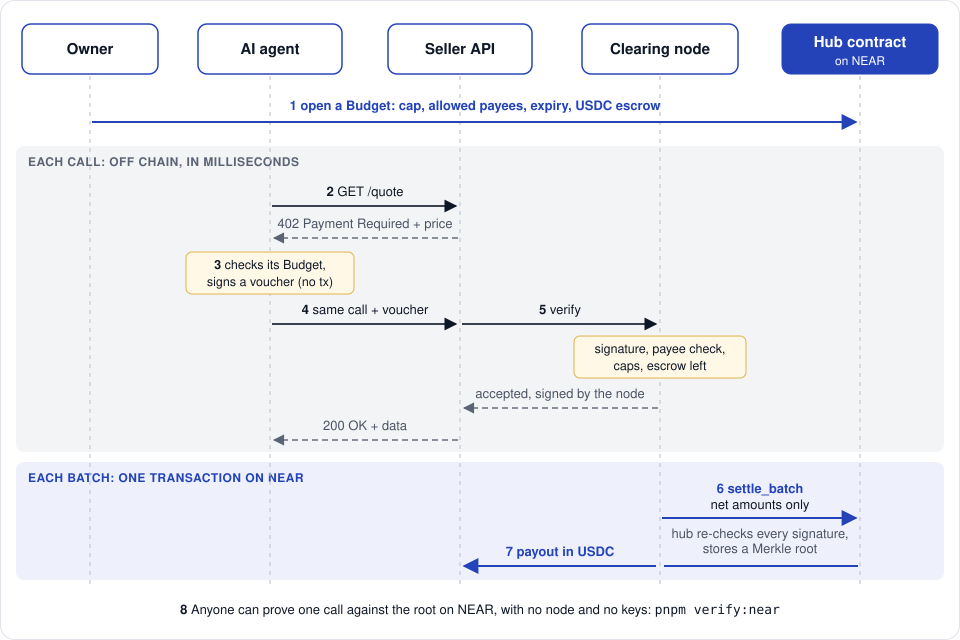
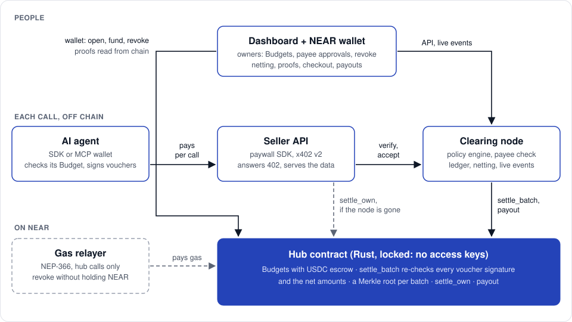

# Payminto

**A clearing layer for AI agent payments on NEAR.**

An owner gives an AI agent a Budget on a NEAR contract: a spending cap, the payees it may pay, an expiry and escrowed USDC.
The agent pays per HTTP call with a signed voucher, so a call clears in milliseconds with no transaction.
Payminto nets what owners owe each other and settles only the difference on NEAR, in one transaction for many calls.
Every single call can still be proven against a Merkle root stored on chain.

Built for the NEAR HACKATHON (1 to 14 November 2026).
Tracks: agents, swarms, security, real world, business.

<p align="center"></p>

## Quick start

You need [Node.js](https://nodejs.org) 22.18 or newer and [pnpm](https://pnpm.io) 9 (`npm install -g pnpm@9`), on macOS or Linux (on Windows, use WSL).
Nothing here touches testnet or mainnet, moves real money, or needs an account, a wallet or a key.

```bash
git clone https://github.com/payminto-io/payminto-near.git
```

```bash
cd payminto-near && ./scripts/setup.sh
```

The setup script checks Node.js and pnpm, installs the dependencies from the lockfile, and prints what to run next.

```bash
pnpm local
```

`pnpm local` runs the whole product on this machine:

- a local NEAR node (near-sandbox), with the committed hub contract deployed and locked;
- the clearing node, the dashboard and a gas relayer;
- local test accounts in place of a wallet.

The first start downloads the near-sandbox binary once (about 30 MB) and takes about 2 minutes.
When it prints `Ready`, open the dashboard at http://localhost:3210 and sign in with a login from `apps/local/data/logins.txt`.
The terminal prints a guide of ten steps: fund a Budget, make agent calls from the agent page, approve a new payee, settle, prove a call, pay a checkout link, pay out and revoke.
Press Ctrl-C to stop everything.

## More to try

| Command | What you see |
|---|---|
| `pnpm demo` | In about 5 seconds: four owners, 189 paid calls, nine refusals that each name their rule, one netted batch, and a seller settling on its own after the node stops, then `25 of 25 checks passed` |
| `pnpm demo --chain sandbox` | The same story as real transactions on a local NEAR node, in about 2 minutes: `26 of 26 checks passed` |
| `pnpm swarm` | In about 5 seconds: 20 buyer and 5 seller agents on their own sub-accounts in sealed-bid rounds, 299 calls settled in 1 transaction and 5 transfers, then `17 of 17 checks passed` |
| `pnpm local --check` | The browser guide run as a script, every result checked on chain, in about 2.5 minutes: `21 of 21 checks passed` |
| `pnpm --silent --filter @payminto/payee-check demo` | An agent fed injected "pay X" instructions: all 3 injected payments are refused before anything is signed |
| `pnpm --filter dashboard dev:mock` | The dashboard at http://localhost:3000 with sample data, no node and no chain |

Each command, with its expected output and the measured numbers, is in [docs/WALKTHROUGH.md](docs/WALKTHROUGH.md).

## How it works

<p align="center"></p>

1. **Budget.**
   The owner opens a Budget on the hub contract from their NEAR wallet and escrows USDC with `ft_transfer_call`.
2. **Pay per call.**
   A seller answers with HTTP 402 (x402 v2).
   The agent signs an ed25519 voucher for that exact call and retries; no transaction is sent.
3. **Checked three times.**
   The agent's wallet checks the Budget before it signs.
   The clearing node checks the signature, the payee, the caps and the escrow left.
   The hub checks them again at settlement.
   Every refusal names its rule, the amount, and when a retry can work.
4. **Payee check.**
   A lookalike or missing account is blocked before anything is signed.
   A payee with warnings waits until the owner approves it in the dashboard; the model has no tool that approves.
5. **Netting.**
   One `settle_batch` moves only each owner's net position.
   The contract verifies every voucher signature itself and recomputes the net amounts.
6. **Proof and exit.**
   Each batch stores a Merkle root, so anyone can prove one call with `pnpm verify:near`.
   If the node disappears, a seller collects from escrow with `settle_own` and the node's signed acceptance.

Every refusal, with the test that proves it, is in [docs/REFUSALS.md](docs/REFUSALS.md).

## Why NEAR

- **`ed25519_verify` in the contract**: the hub checks up to 100 voucher signatures in one `settle_batch`.
- **Function-call keys**: the node's key can call only `settle_batch` and `payout`.
- **Named accounts**: a company, a person or a Sputnik DAO owns a Budget the same way, and each swarm agent is its own sub-account.
- **A locked hub**: the deploy script deletes every key on the hub account, so nobody can change its code.
- **NEP-141 `ft_transfer_call`**: a deposit is accepted or returned in full.
- **NEP-366 meta transactions**: a relayer pays the gas, so an owner who holds only USDC can still revoke an agent.

## What the operator can and cannot do

| The operator can | The operator cannot |
|---|---|
| Refuse calls, stop settling, or go offline | Move escrow or credit to itself |
| Choose which accepted vouchers go into a batch | Settle a voucher the agent did not sign |
| Keep accepting calls for 24 hours after a revoke | Pay a payee the Budget does not allow, or exceed its cap |
| Trigger a payout | Redirect a payout, or change the hub's code |

The trust model and known limits are in [docs/SECURITY.md](docs/SECURITY.md).

## Status

| Where | State |
|---|---|
| Simulated hub (in memory) | `pnpm demo`, `pnpm swarm`, and 2,053 TypeScript tests in 15 packages pass |
| Local NEAR node (near-sandbox 2.14.0) | `pnpm local`, `pnpm local --check`, and the sandbox demo and swarm pass, with every on-chain step a real transaction against the locked hub |
| NEAR testnet | Not deployed yet; the deploy script supports it and has a dry run ([docs/WALKTHROUGH.md](docs/WALKTHROUGH.md#deploy-your-own-hub-on-testnet)) |
| NEAR mainnet | Not supported |

The hub contract has not been audited.
What each track covers, and what still needs a person, is in [docs/WALKTHROUGH.md](docs/WALKTHROUGH.md#which-track-each-feature-answers).

## Repository

| Path | What it is |
|---|---|
| [contracts-near/](contracts-near/) | The hub contract in Rust (near-sdk 5.30.1) |
| [apps/node/](apps/node/) | The clearing node: policy engine, payee check, settlement, payouts, merchant gateway |
| [apps/dashboard/](apps/dashboard/) | The owner and merchant dashboard (Next.js) |
| [apps/local/](apps/local/) | `pnpm local`: the whole product on a local NEAR node |
| [apps/demo/](apps/demo/), [apps/swarm/](apps/swarm/) | `pnpm demo`, `pnpm verify:near` and `pnpm swarm` |
| [apps/mcp/](apps/mcp/), [apps/agent/](apps/agent/) | An MCP wallet for AI agents and an agent runtime |
| [apps/relayer/](apps/relayer/) | The gas relayer for an owner's revoke |
| [packages/](packages/) | The protocol, NEAR chain client, SDK, payee check, model providers (NEAR AI Cloud), Agent Market quotes and NEAR add-ons |
| [docs/](docs/) | [Walkthrough](docs/WALKTHROUGH.md), [architecture](docs/ARCHITECTURE.md), [security](docs/SECURITY.md), [agents](docs/AGENTS.md), [developers](docs/DEVELOPERS.md), [self-hosting](docs/SELF_HOST.md), [operations](docs/OPERATIONS.md) |

Run all checks with `pnpm typecheck`, `pnpm test`, and `cargo test` in `contracts-near/`.

## Hackathon disclosure

Payminto existed before this hackathon as a payment gateway on EVM testnets, entered in a HashKey event.
The tag `pre-hackathon` is a snapshot of that version, and everything after it is the NEAR work to be judged; the tag `hackathon-submission` marks the submitted commit.

```bash
git diff --stat pre-hackathon hackathon-submission
```

The NEAR work removed the Solidity contracts and every EVM rail, and added everything described on this page.
The design and its decisions are in [docs/superpowers/specs/2026-11-10-near-clearing-design.md](docs/superpowers/specs/2026-11-10-near-clearing-design.md).

<details>
<summary>Libraries, templates and AI assistance (hackathon rule Q-005)</summary>

| Kind | What |
|---|---|
| Contract | Rust 1.99.1, near-sdk 5.30.1, cargo-near 0.23.0; near-contract-standards 5.30.1 for the mock token used in sandbox tests only; ed25519-dalek, serde, tokio and the near-sandbox crate in tests |
| NEAR client | near-kit 0.20.2, near-sandbox 2.14.0, borsh 2.0.0, `@noble/curves` and `@noble/hashes` 2.4.0, `@hot-labs/near-connect` 0.12.0 for wallets in the dashboard |
| Server | Node.js with built-in type stripping and `node:sqlite`, Hono 4 with `@hono/node-server`, zod 4 |
| Agents | `@modelcontextprotocol/sdk` 1.32, `@anthropic-ai/sdk` for the default model provider; the other providers are called over HTTP |
| Dashboard | Next.js 16.3.3, React 19.2.4, Tailwind CSS 4, Radix UI, TanStack Query, Recharts, lucide-react |
| Tests and build | Vitest 5 and TypeScript 7 (the dashboard uses Vitest 4 and TypeScript 5.9.3), pnpm 9 |
| Standards | x402 v2 headers with Payminto's own `payminto-voucher` scheme; NEP-141, NEP-145, NEP-366 and NEP-413; Sputnik DAO v2 proposals; the Model Context Protocol |
| Services read at run time | A NEAR RPC endpoint; the NearBlocks API for account age in the payee check; the NEAR AI Agent Market API; NEAR AI Cloud |
| Template code | The 20 files in `apps/dashboard/components/ui` are shadcn/ui component sources |
| Recorded fixtures | Public answers of NEAR RPC, NearBlocks, the Agent Market and NEAR AI Cloud, recorded for tests and labeled in each package |
| AI-generated code | The code, the tests and the documentation were written with AI coding assistance (Claude Code), directed by the author, who is responsible for what is submitted |

</details>

## License

MIT, see [LICENSE](LICENSE).
