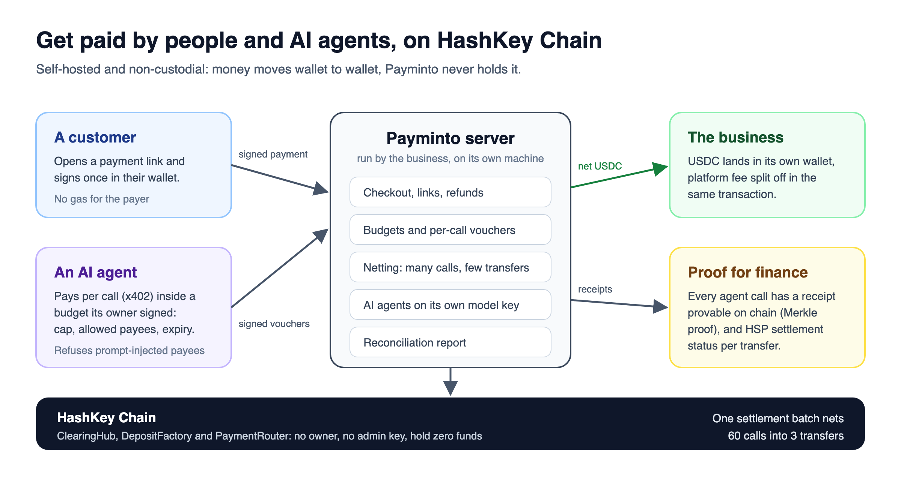

# Payminto

**Get paid in stablecoins by people and AI agents, on your own server.**



**[Watch the 3-minute demo](https://youtu.be/G2QipGsU6ZM)**: real AI agents paying each other, people paying a business, and one prompt that installs your own, on HashKey Chain Testnet.

Payminto is a self-hosted, non-custodial payment gateway for HashKey Chain.
Share one payment link: a person pays it from their wallet, and an AI agent pays it automatically.
Money goes straight to the business's wallet with the platform fee split off in the same transaction, so nobody holds it, not even us.

## What it does

- **Payments from people**: payment links, hosted checkout, deposit addresses, gasless refunds, webhooks and a reconciliation report.
- **Payments from AI agents**: x402 per-call payments inside an owner-signed budget (cap, allowed payees, expiry), so a prompt-injected agent cannot pay a stranger.
- **Netting**: thousands of tiny agent charges settle as a few transfers, and every call keeps a receipt provable on chain.
- **The business's own AI agents**: a back-office agent and paid AI skills, on the business's own model key (Anthropic, OpenAI, Gemini, OpenRouter, Replicate and more).
- **HSP**: HashKey's settlement protocol status on every net transfer.

## Live on testnets

The same contracts run on HashKey Chain Testnet and Ethereum Sepolia (Circle USDC); they have no owner, no admin key and never hold funds.

| Contract | Address (both chains) |
|---|---|
| ClearingHub | `0x53E4B5712fEeD40dd6597F0A50cC14C063186e81` |
| DepositFactory | `0xcBAFd928dF0C40EDccEC7b82bCaee4a6Ae0E094b` |
| PaymentRouter | `0x1e0f2223D61BF9831fa0b009AE741c3F5E898F0e` |

A full live run on HashKey Chain Testnet: [agent calls netted and settled](https://testnet-explorer.hskchain.net/tx/0xebef334562fc83fb4403f55c7e588c08bb9dc60f1b78e1ffb0eeb80350bb51ad), [a customer's wallet payment](https://testnet-explorer.hskchain.net/tx/0x7a1fb3961cc99184f433c452934bd307d0108abfb75466af7de9d68894ab1493), [an AI agent paying another agent's skill](https://testnet-explorer.hskchain.net/tx/0x5b0733e7c2ca0a0613924197d6f64a2c451c8da869f504a6a945a6ca48df173f), [a gasless refund](https://testnet-explorer.hskchain.net/tx/0x33d833ffa7153f7a10e201743e90daba13ae1b3745d67d39584969b4f5a78c76).
Every address and step is in [docs/TESTNET.md](docs/TESTNET.md).

## Quickstart

With your AI coding agent: clone this repository, open Claude Code in it, and paste:

> Follow https://github.com/sagarjethi/payminto-clearing/blob/main/docs/SELF_HOST.md to run my own Payminto. Start with Path A.

With Docker, on a private test chain with no real money:

```bash
docker compose --profile local up --build
```

Then open http://localhost:3000/setup with the setup code `dev-admin-token`.

The whole story in one command (Node 22.18+, pnpm 9, Foundry):

```bash
pnpm install && pnpm demo
```

## Learn more

| | |
|---|---|
| [docs/SELF_HOST.md](docs/SELF_HOST.md) | Run your own, step by step |
| [docs/DEVELOPERS.md](docs/DEVELOPERS.md) | Architecture, repository, tests, gateway and agents in detail |
| [docs/GATEWAY.md](docs/GATEWAY.md) | Payments, refunds, webhooks, HSP |
| [docs/AGENTS.md](docs/AGENTS.md) | The business's AI agents |
| [docs/ARCHITECTURE.md](docs/ARCHITECTURE.md) | Trust model and known limits |

## Status

- Testnets only: there is no mainnet deployment yet, and testnet tokens have no value.
- HSP runs through Payminto's built-in adapter until HashKey allowlists the server's IP for its HSP service.
- Contract findings to fix before mainnet are listed in [docs/ARCHITECTURE.md](docs/ARCHITECTURE.md).

MIT licensed.
